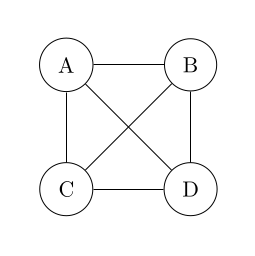
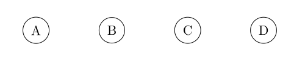
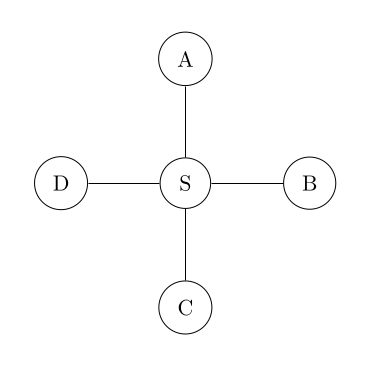

# Grapl

This is an implementation of an idea I had for a better graph notation back in
2019. The original idea was outlined [here][blog-1], however this crate aims to
extend this basic idea with some extensions for making graphs with ad-hoc edges
and set-like operations. Stay tuned!

## Syntax

### Fully Connected Graph

```
{A, B, C, D}
```


### Fully Disconnected Graph

```
[A, B, C, D]
```


`[...]` adds no edges between its members, but it doesn't forbid them either.
Members that share a node are joined through it, so `[N, {N, J}]` is the same
graph as `{N, J}`.

### Distributivity

```
{S, [A, B, C, D]}
=> normalize
[{S, A}, {S, B}, {S, C}, {S, D}]
```


### Directed Graph

```
(A, B, C)
```

Parentheses are ordered. Every member gets an edge to every *later* member, so
`(A, B, C)` is `A -> B`, `A -> C`, `B -> C` (a transitive tournament, not a
path). `{A, B}` is just `[(A, B), (B, A)]`, which makes the undirected forms
a special case of the directed one, and the two mix freely:

```
(A, {B, C})
=> normalize
[(A, B, C), (A, C, B)]

{S, (A, B)}
=> normalize
[(S, A, B), (A, B, S)]
```

Reversing every `(...)` reverses every edge.

### Paths

```
A -> B -> C
=> normalize
[(A, B), (B, C)]
```

Arrows are sugar for a chain of two-element directed graphs.

### Resolution
[WIP #1](https://github.com/nixpulvis/grapl/pull/1)

```
G1 = [A, B]
G2 = {X, G1}
=> resolve => normalize
G1 = [A, B]
G2 = [{X, A}, {X, B}]
```


[blog-1]: https://nixpulvis.com/ramblings/2025-08-15-graph-notation
